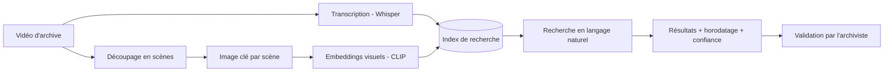

# Archive Sauvée

> **Rendre les archives audiovisuelles cherchables, sans jamais remplacer l'humain.**
> Projet présenté au hackathon **IA Éthique 360** (5ᵉ édition), organisé par la Junior Entreprise INSAT et l'OIF.
> Sous-thématique : *L'intégration de l'intelligence artificielle dans les industries audiovisuelles à vocation culturelle*.

---

## Sommaire

1. [Le problème](#1-le-problème)
2. [Comment nous l'avons détecté](#2-comment-nous-lavons-détecté)
3. [La solution](#3-la-solution)
4. [Place de l'IA](#4-place-de-lia)
5. [Démarche éthique à 360°](#5-démarche-éthique-à-360)
6. [Architecture](#6-architecture)
7. [Installation et démo](#7-installation-et-démo)
8. [État actuel et limites](#8-état-actuel-et-limites)
9. [Modèle économique](#9-modèle-économique)
10. [Équipe et répartition des tâches](#10-équipe-et-répartition-des-tâches)
11. [Licences et sources des données](#11-licences-et-sources-des-données)
12. [Prochaines étapes](#12-prochaines-étapes)

---

## 1. Le problème

**En une phrase :**

> Les **archivistes et chercheurs** rencontrent **des difficultés à retrouver une séquence précise** dans des archives audiovisuelles **peu ou pas documentées (bandes anciennes, métadonnées absentes)**, ce qui entraîne **des contenus culturels inexploités, des heures de visionnage manuel et un risque de perte du patrimoine**.

**Qui est concerné ?** Cinémathèques, archives de télévision et de radio, documentaristes, chercheurs, producteurs.

**Pourquoi c'est important ?** Un contenu qu'on ne peut pas retrouver est un contenu qui ne peut ni être étudié, ni réutilisé, ni transmis.

---

## 2. Comment nous l'avons détecté

> **Note de transparence :** À ce stade de la première soumission, ce problème est une **hypothèse en cours de validation**. N'ayant pas pu obtenir d'entretien direct avec les responsables des radios ou de la Cinémathèque locale dans les délais impartis, nous nous sommes basés sur la documentation publique concernant la numérisation des archives.

| Source | Détail | Date |
|---|---|---|
| Recherche documentaire | Rapports sur les défis de numérisation du patrimoine audiovisuel (absence récurrente de métadonnées) | Nov. 2026 |
| Observation de l'écosystème | Les documentaristes se plaignent fréquemment du temps passé à visionner des rushs non indexés. | Nov. 2026 |

**Notre plan pour valider cette hypothèse (Prochaines étapes) :** 
Nous prévoyons de contacter directement les archivistes de l'Établissement de la Télévision Tunisienne et de la Cinémathèque Tunisienne lors de la phase d'accompagnement pour affiner notre solution avec leurs retours terrain.

---

## 3. La solution

**Archive Sauvée** est un outil qui prend une vidéo d'archive et en construit un **index consultable**. On peut ensuite y chercher comme sur un moteur de recherche, par exemple *« scènes de marché avec foule »*.

Pour chaque vidéo, l'outil :

1. **découpe** la vidéo en scènes ;
2. **transcrit** la parole (français, arabe, dialecte tunisien, mélange de langues) ;
3. **décrit** le contenu visuel de chaque scène ;
4. **permet la recherche** en langage naturel et renvoie les moments correspondants avec leur horodatage ;
5. **laisse l'archiviste valider ou corriger** chaque proposition.

**Principe fondamental :** l'IA **propose**, l'humain **décide**. La vidéo originale n'est **jamais modifiée**.

---

## 4. Place de l'IA

| Étape | Technologie | Pourquoi l'IA est nécessaire |
|---|---|---|
| Détection de scènes | PySceneDetect | Automatiser un découpage qui prendrait des heures à la main |
| Transcription | Whisper (modèle ouvert, exécution locale) | Rendre la parole cherchable |
| Description visuelle et recherche | Embeddings CLIP | Chercher des images avec des mots, sans étiquetage manuel |

**Ce que l'IA ne fait pas :** elle ne modifie pas les œuvres, n'identifie pas les personnes par leur visage et ne prend aucune décision finale.

---

## 5. Démarche éthique à 360°

Nous examinons notre projet sous les six angles du cahier des charges.

### 👤 Les créateurs : qui garde la main ?
- L'archiviste **valide, corrige ou rejette** chaque transcription et chaque étiquette.
- L'outil **décrit** les œuvres, il ne les **transforme** pas.
- **Risque :** l'utilisateur fait trop confiance aux suggestions. **Atténuation :** affichage d'un niveau de confiance et statut « à valider » par défaut.

### ⚖️ Les droits : consentement, droits d'auteur
- Chaque document indexé porte une **fiche de droits** (titulaire, licence, usages autorisés). Dans notre prototype actuel, un champ 'Droits et Licence' est obligatoirement renseigné avant l'analyse.
- Nos démonstrations utilisent **uniquement** des vidéos libres de droits (voir [§ 11](#11-licences-et-sources-des-données)).
- **Risque :** indexer une œuvre dont les droits sont flous. **Atténuation :** champ « droits » obligatoire avant diffusion.

### 🗃️ Les données : d'où viennent-elles ?
- Nous **n'entraînons aucun modèle** : nous utilisons des modèles pré-entraînés ouverts, dont nous citons les licences.
- Aucun contenu n'est collecté sans autorisation.
- **Risque :** biais hérités des modèles pré-entraînés. **Atténuation :** tests sur nos propres extraits et limites publiées (§ 8).

### 🌍 Cultures et langues : que met-on en avant, qu'efface-t-on ?
- Le projet cible le français, l'arabe et le **dialecte tunisien**, souvent mal couverts par les outils grand public.
- **Risque :** une transcription moins fiable sur le dialecte et les mélanges de langues peut invisibiliser ces contenus. **Atténuation :** mesure honnête de la précision, validation humaine, enrichissement futur avec des locuteurs.
- Les descriptions visuelles restent **neutres** : pas de déduction sur l'origine, la religion ou les émotions des personnes.

### 🔎 La transparence : le public sait-il ce que fait l'IA ?
- Chaque étiquette est marquée **« générée par IA »** et indique son **statut de validation** (proposée / validée par un humain).
- Les résultats de recherche indiquent leur niveau de confiance.
- Le code et la méthode sont **ouverts** dans ce dépôt.

### 🌱 La planète : quel coût énergétique pour quel bénéfice ?
- Modèles **de petite taille**, exécutés **en local**, sans appel permanent à un service cloud gourmand en énergie.
- Traitement **une seule fois** par document, puis réutilisation de l'index textuel très léger.
- Sur notre prototype, l'analyse complète d'une minute de vidéo prend moins de deux minutes sur un processeur standard (CPU), limitant considérablement l'empreinte carbone.

### Risques résiduels reconnus
- Précision limitée sur l'audio dégradé et le dialecte.
- Descriptions visuelles parfois erronées.
- La qualité finale dépend entièrement d'une validation humaine disponible.

---

## 6. Architecture



**Structure du dépôt** 

```text
archive-sauvee/
├── README.md
├── requirements.txt
├── data/
│   └── clips/            # Extraits de démonstration du domaine public
├── src/
│   ├── ingest.py         # Découpage, transcription, embeddings
│   ├── search.py         # Recherche en langage naturel
│   └── app.py            # Interface locale Streamlit/Gradio
└── LICENSE
```

---

## 7. Installation et démo

**Prérequis :** Python 3.10+, `ffmpeg` installé.

```bash
# 1. Cloner le dépôt
git clone https://github.com/VOTRE_COMPTE/archive-sauvee.git
cd archive-sauvee

# 2. Installer les dépendances
python -m venv .venv
source .venv/bin/activate        # Windows : .venv\Scripts\activate
pip install -r requirements.txt

# 3. Indexer un extrait de démonstration
python src/ingest.py --video data/clips/extrait_demo.mp4

# 4. Lancer une recherche (ou l'interface web)
python src/app.py
```

**Vidéo de démonstration :** *[Lien du video à ajouter pour la soumission finale]*

---

## 8. État actuel et limites

Nous préférons être transparents sur ce qui fonctionne et ce qui ne fonctionne pas encore dans ce prototype.

| Fonctionnalité | État |
|---|---|
| Découpage en scènes | ✅ Fonctionnel |
| Transcription (français) | ✅ Fonctionnel |
| Transcription (dialecte tunisien) | 🟡 Partiel (précision limitée sur les termes très locaux) |
| Recherche visuelle en langage naturel | ✅ Fonctionnel |
| OCR du texte à l'écran | ❌ Prévu pour de futures itérations |
| Interface de validation | ✅ Maquette locale fonctionnelle |
| Fiche de droits par document | 🟡 Partiellement simulée en base de données JSON |


---

## 9. Modèle économique

- **Clients visés :** cinémathèques, archives de télévision et de radio, universités, documentaristes, producteurs indépendants.
- **Proposition de valeur :** retrouver et réutiliser un patrimoine audiovisuel sans visionnage manuel chronophage, avec un outil exécutable localement (sans cloud) et respectueux des droits des créateurs.
- **Revenus envisagés :** Modèle B2B via abonnement logiciel ou licence d'exploitation par structure, couplé à des prestations d'accompagnement à l'indexation.
- **Soutien à la création :** chaque œuvre indexée conserve sa fiche de droits, ce qui facilite la rémunération des ayants droit lors d'une réutilisation commerciale.

---

## 10. Équipe et répartition des tâches

> **Note de l'équipe :** Le développement logiciel de ce prototype a été un effort collaboratif. Tous les membres de l'équipe ont activement participé à l'écriture du code source (scripts d'ingestion, modèles IA, interface), en plus des responsabilités d'organisation listées ci-dessous.

| Membre | Rôle | Responsabilités |
|---|---|---|
| **[Amine Jelassi]** | Coordination & Pitch | Contact organisateurs, gestion de projet, présentation finale |
| **[Rayen Mnif]** | Terrain et éthique | Veille documentaire, section éthique, modélisation des risques |
| **[Youssef Ben Arbia]** | IA / Data Pipeline | Implémentation de Whisper, CLIP, scripts d'ingestion |
| **[Med Aziz Ayari]** | Interface et démo | Développement Streamlit/Gradio, enregistrement de la vidéo |


---

## 11. Licences et sources des données

**Vidéos de démonstration**

| Fichier | Source | Licence / droits | Autorisation |
|---|---|---|---|
| `placeholder` | `placeholder` | `placeholder` | `placeholder` |

**Modèles et bibliothèques utilisés**

| Composant | Licence |
|---|---|
| Whisper (OpenAI) | MIT License |
| OpenCLIP | MIT License |
| PySceneDetect | BSD 3-Clause |

**Licence du projet :** MIT License

---

## 12. Prochaines étapes

- [ ] Valider le besoin et les priorités avec des archivistes de la Cinémathèque Tunisienne ou d'une radio locale.
- [ ] Mesurer concrètement la précision de la transcription sur le dialecte tunisien et l'améliorer via fine-tuning.
- [ ] Connecter l'interface de validation actuelle à une véritable base de données persistante (ex: PostgreSQL).
- [ ] Préparer le Business Model Canvas complet pour la grande finale du 25 novembre.

---

## Contact

Équipe **[jweh ser el njeh]** · **[amine.jelassi7@gmail.com]**

Projet réalisé dans le cadre du hackathon **IA Éthique 360** · Junior Entreprise INSAT × Organisation internationale de la Francophonie.