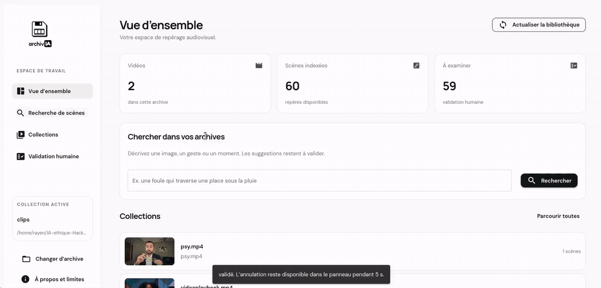
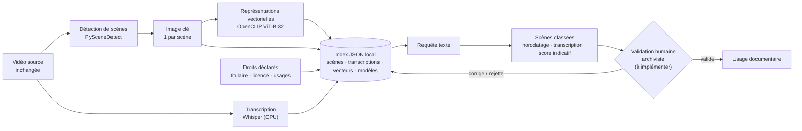

<div align="center">

# ArchivIA

**La mémoire audiovisuelle, retrouvée sans être réécrite.**

[](https://www.python.org/)
[](LICENSE)
[](#statut-du-prototype)
[](#architecture-technique)


<sub><strong>Équipe ArchivIA</strong> · Projet de la 5e édition du hackathon <strong>IA Éthique 360</strong>, organisé par la Junior Entreprise INSAT et l'Organisation internationale de la Francophonie (OIF).</sub>

</div>

---

**ArchivIA** indexe localement des archives audiovisuelles et permet de retrouver une scène à partir d'une requête en langage naturel, sans jamais remplacer la décision de l'archiviste.

<p align="center">
  
</p>

<p align="center"><em>Exemple de recherche sur un extrait de test local. Les scores sont indicatifs ; chaque résultat reste « proposé ».</em></p>

> **Preuve terrain :** le problème est une **hypothèse de travail**, pas encore validée par des entretiens. La section 1 documente la méthode et l'espace réservé aux comptes rendus.
=======
- Aucun clip autorisé n'est fourni dans le dépôt : l'équipe doit choisir un fichier dont elle peut justifier les droits et usages.
- Aucun test de qualité, de vitesse ou de précision n'a encore été consigné. La qualité du français, de l'arabe et du tunisien n'est donc pas mesurée.
- Le modèle CLIP configuré utilise des poids LAION `ViT-B-32`; sa pertinence pour des requêtes françaises ou tunisiennes doit être évaluée, pas présumée.
- Premier contrôle manuel rapporté par l'équipe : pour la requête « la Terre vue depuis l'espace » sur `test.mp4`, deux résultats affichés ont été vérifiés et jugés pertinents. Il s'agit d'un contrôle ponctuel, pas d'une mesure de précision ni d'un benchmark.
- La transcription est faite sur le CPU et l'installation des modèles peut demander beaucoup de temps, d'espace disque et de mémoire. Les poids sont téléchargés par les bibliothèques au premier lancement, puis l'inférence se fait localement.
- Pas encore d'interface de validation, d'OCR, de gestion multi-utilisateur ou de mesure d'empreinte énergétique.

## Sommaire

- [1. Le problème détecté](#probleme)
- [2. Innovation et place de l'IA](#ia)
- [3. Démarche éthique à 360°](#ethique)
- [4. Faisabilité](#faisabilite)
- [5. Feuille de route](#feuille-de-route)
- [6. Modèle économique — Business Model Canvas](#modele-economique)
- [7. Contribuer](#contribuer)
- [8. Licence](#licence)

## En bref

| Point clé | Résumé |
|---|---|
| **Problème** | Retrouver une séquence précise dans une archive audiovisuelle peu documentée demande un visionnage long et manuel. |
| **Solution** | Un index local, multimodal et interrogeable en langage naturel, avec validation humaine prévue. |
| **IA** | Détection de scènes, transcription Whisper, représentations vectorielles visuelles OpenCLIP. |
| **Statut** | Chaîne de traitement en ligne de commande fonctionnelle de bout en bout sur un extrait de test local ; validation terrain à venir. |
| **Éthique** | Six angles documentés, refus explicites, aucune décision automatique. |
| **Équipe** | 4 membres ; répartition des rôles à confirmer. |

---

<a id="probleme"></a>
## 1. Le problème détecté

> **Critère 1 · Pertinence du problème détecté (30 %)**

> « Un archiviste ou un documentaliste audiovisuel rencontre un problème de repérage lorsqu'il doit retrouver une séquence précise dans un fonds peu documenté, ce qui entraîne un temps de visionnage important, des contenus culturels difficiles à réutiliser et un risque d'invisibilité de certaines œuvres. »

**Statut de cette affirmation : hypothèse de travail, non encore validée sur le terrain.** Des demandes d'entretien ont été envoyées ; aucune réponse exploitable n'est encore disponible. Nous ne présentons donc pas cette phrase comme un constat établi.

### Pourquoi cette hypothèse est crédible

Une archive audiovisuelle n'est pas seulement un fichier : c'est un document avec un contexte, des ayants droit et des usages prévus. Quand les métadonnées s'arrêtent au niveau du fonds ou de l'émission, retrouver « la scène où… » suppose de parcourir la vidéo, de reconnaître les plans et de reconstituer mentalement le récit. Ce travail peut être coûteux, difficile à mutualiser et dépendre fortement de la mémoire des personnes qui connaissent le fonds.

L'IA ne supprime pas ce travail. Elle peut réduire la distance entre une question formulée en mots et un signal visuel ou sonore qui n'a jamais été décrit. C'est là que se situe notre contribution : un index intermédiaire, proposé par la machine, validé par l'humain.

### Comment nous l'avons détecté — et ce qui reste à prouver

| Méthode | Ce que nous avons fait | Statut | Ce qui manque |
|---|---|---|---|
| **Entretiens semi-directifs** | Demandes envoyées à des professionnels des archives et de l'audiovisuel. | En attente | Comptes rendus datés, rôles, citations autorisées. |
| **Observation d'une tâche réelle** | Protocole prêt : chronométrer une recherche de séquence, noter les étapes et les contournements. | À planifier | Accord de la structure, grille d'observation. |
| **Veille documentaire** | Cadres internationaux de l'UNESCO et du Conseil international des archives sur la préservation et l'accès au patrimoine documentaire. | Amorcé | Sources locales, rapports d'archives, données tunisiennes. |
| **Test technique** | Chaîne de traitement exécutée de bout en bout sur un extrait local. | Fait | Corpus de test documenté et droits vérifiés. |

**Notre règle de preuve :** nous ne présenterons le problème comme validé que si au moins deux professionnels indépendants décrivent la même difficulté et si nous pouvons documenter un cas concret — temps passé, contournement utilisé, contenu resté introuvable. Les notes seront publiées avec l'accord des personnes, ou anonymisées.

<details>
<summary><strong>Journal de terrain — modèle à remplir après les entretiens</strong></summary>

Aucun entretien exploitable à ce jour. Le tableau ci-dessous ne contient aucun nom inventé ; il sera rempli au fur et à mesure, avec l'accord des personnes.

| Date | Personne / rôle | Structure | Observation | Preuve / accord de citation |
|---|---|---|---|---|
| — | — | — | — | — |
| — | — | — | — | — |
| — | — | — | — | — |

**Questionnaire de départ (extrait) :**

1. Comment retrouvez-vous aujourd'hui une séquence précise dans un fonds peu documenté ?
2. Combien de temps cela prend-il, et quelles étapes sont les plus coûteuses ?
3. Quels outils utilisez-vous : catalogue, tableur, moteur de recherche, mémoire d'équipe ?
4. Qu'est-ce qui vous ferait perdre confiance dans une suggestion automatique ?
5. Quels droits et quels accords sont nécessaires avant d'indexer un contenu ?

</details>

### Sources publiques

| Source | Ce qu'elle documente | Lien |
|---|---|---|
| UNESCO, *Recommandation concernant la préservation et l'accessibilité du patrimoine documentaire, y compris le patrimoine numérique* (17 novembre 2015), qui cite la Recommandation de 1980 sur les images en mouvement | Cadre international pour la préservation et l'accès ; appelle notamment à des « catalogues et aides à la recherche exacts et mis à jour » (section 3.2). | [Texte officiel](https://www.unesco.org/fr/legal-affairs/recommendation-concerning-preservation-and-access-documentary-heritage-including-digital-form) |
| Conseil international des archives, *Déclaration universelle sur les archives* (2011), adoptée par l'UNESCO | Affirme que les archives garantissent les droits, constituent une mémoire collective et soutiennent la transparence des institutions. | [Présentation officielle](https://www.ica.org/en/universal-declaration-on-archives) |
| **À compléter** | Rapports de l'INA, politiques de numérisation, Archives nationales de Tunisie, enquêtes de terrain. | — |

> **Attention :** une source publique documente un enjeu général ; elle ne remplace pas un entretien. Nous ne l'utilisons pas pour prétendre que notre problème précis est confirmé.

---

<a id="ia"></a>
## 2. Innovation et place de l'IA

> **Critère 2 · Innovation et place de l'IA (25 %)**

### Ce que fait ArchivIA

| Étape | Entrée | Traitement | Sortie |
|---|---|---|---|
| **1. Ingestion** | Une vidéo dont les droits sont déclarés | Détection de scènes, extraction d'une image clé par scène, transcription audio, calcul de représentations vectorielles visuelles | Des scènes horodatées |
| **2. Indexation** | Les scènes et les métadonnées de droits | Écriture d'un index JSON local | `data/index.json` |
| **3. Recherche** | Une requête en langage naturel | Similarité texte-image + recouvrement de mots dans la transcription | Scènes classées, horodatages, transcription, score indicatif |

Le prototype est une interface en ligne de commande (CLI). Il ne modifie jamais la vidéo source : il lit, extrait et écrit un index dérivé. Les images clés et l'index restent sur la machine.

### Pourquoi l'IA est nécessaire

- **Le signal à interroger est visuel et sonore**, pas seulement textuel. Le contenu n'est pas toujours décrit plan par plan.
- **Décrire chaque plan à la main est coûteux et ne passe pas à l'échelle**, surtout pour des fonds anciens ou faiblement dotés.
- **Un modèle multimodal peut relier une requête en français à des images jamais annotées**, et un modèle de transcription peut rendre la parole cherchable sans écoute intégrale.
- **L'IA n'est nécessaire que pour proposer des candidats**, pas pour décider de leur valeur documentaire.

### Ce que l'IA fait — et ce qu'elle ne fait pas

| L'IA fait | L'IA ne fait pas |
|---|---|
| Découper la vidéo en scènes probables | Décider qu'une scène est importante |
| Extraire une image clé par scène | Garantir que l'image représente tout le plan |
| Transcrire la parole | Garantir une transcription exacte |
| Calculer une proximité texte-image | Certifier la pertinence d'un résultat |
| Classer des candidats | Publier ou valider une métadonnée |
| Signaler `proposé` et `generated_by_ai` | Remplacer l'archiviste |
| — | Reconnaître les visages, les émotions, l'origine, la religion ou l'identité |
| — | Vérifier les droits automatiquement |

### Modèles et outils

| Étape | Outil / modèle | Version | Sortie | Contrôle humain |
|---|---|---|---|---|
| Détection de scènes | PySceneDetect `ContentDetector` | 0.7.3 | Limites de scènes probables | Vérifier les coupes |
| Transcription | OpenAI Whisper `base` (configurable `tiny`, `base`, `small`) | 20250625 | Segments textuels horodatés | Écouter, corriger |
| Recherche visuelle | OpenCLIP `ViT-B-32`, poids `laion2b_s34b_b79k` | 4.2.2 | Vecteur visuel | Interpréter |
| Recherche textuelle | Similarité cosinus + recouvrement de mots (coefficient 0,05) | code du projet | Score indicatif | Ne pas lire comme une probabilité |
| Index | JSON, `schema_version: 1` | code du projet | Scènes, droits, modèles | Réviser |

**Aucun modèle n'est réentraîné.** Les poids sont téléchargés au premier lancement, puis l'inférence se fait localement. Whisper tourne sur CPU dans le prototype ; OpenCLIP utilise CUDA si disponible. Les versions sont épinglées dans `requirements.txt`.

### Où est l'innovation

L'innovation n'est pas dans un nouveau modèle. Elle est dans l'assemblage : une chaîne de traitement locale, reproductible et traçable, qui traite la vidéo, l'audio et les droits dans un même index, et qui refuse de transformer une similarité en décision. Le résultat est un outil d'aide à la consultation, pas un moteur de publication.

Le prototype est volontairement petit et lisible : pas de réentraînement, pas de génération d'images, pas de synthèse de voix. Cette sobriété facilite l'audit et limite les risques.

---

<a id="ethique"></a>
## 3. Démarche éthique à 360°

> **Critère 3 · Démarche éthique à 360° (25 %)**

### Notre boussole

ArchivIA part d'une règle simple : **indexer n'est pas réécrire**. Le système peut proposer des scènes, des transcriptions et des similarités ; il ne peut ni déclarer une œuvre libre, ni décider qu'une interprétation est correcte, ni publier à la place d'un professionnel.

Les six angles ci-dessous ne sont pas une liste de cases à cocher. Ils décrivent des tensions réelles et les garde-fous que nous pouvons tenir — ou que nous devons encore construire.

### Les six angles

| Angle | Notre approche | Risque | Mitigation |
|---|---|---|---|
| **Créateurs** | L'IA propose, l'archiviste dispose. La vidéo source reste intacte ; chaque scène porte le statut `proposé`. Le crédit des auteurs et des ayants droit doit être conservé dans les métadonnées (champ à compléter dans le schéma). | Automatisation de la description, effacement du travail éditorial, décontextualisation d'une œuvre, crédit insuffisant. | Validation humaine avant tout usage ; provenance et crédits dans l'index ; pas de génération ni de remontage ; journal des corrections. |
| **Droits** | Trois champs sont exigés à l'ingestion : titulaire, licence ou statut, usages autorisés. La CLI ne vérifie pas leur véracité. | Ingestion d'œuvres protégées, œuvres orphelines, confusion entre licence du code et droits du contenu, réutilisation non autorisée. | Fiche de droits par clip ; registre ; revue juridique avant pilote ; pas de distribution des clips ; procédure de retrait ; aucune publication automatique. |
| **Données** | Traitement local, pas de cloud ; index minimal ; pas de reconnaissance faciale ni d'inférence identitaire. Les images clés et l'index sont ignorés par Git. | Contenus sensibles, données personnelles, fuite de l'index, conservation trop longue, accès non autorisé. | Minimisation ; stockage local ; contrôle d'accès et chiffrement prévus ; purge ; pas d'upload ; journal d'accès. |
| **Cultures et langues** | Ne pas supposer que le français, l'arabe et le tunisien fonctionnent aussi bien. Le prototype permet de choisir la langue Whisper ; les performances doivent être mesurées par langue. | Biais des modèles préentraînés, erreurs de transcription, requêtes mal comprises, sous-représentation de certaines cultures, invisibilité accrue. | Jeu de test annoté FR / AR / tunisien ; taux d'erreur de mots et précision par langue ; correction humaine ; glossaire ; documenter les limites ; ne pas revendiquer la parité. |
| **Transparence** | Statut `proposé`, indicateur `generated_by_ai`, score indicatif, versions des modèles dans l'index. Le README documente les limites. | Fausse confiance dans les scores, boîte noire, confusion entre similarité et probabilité, résultats non contestables. | Libellés explicites ; aucun score présenté comme une certitude ; journal des modèles ; documentation ; possibilité de rejeter ; interface de validation à venir. |
| **Planète** | Pas de réentraînement ; modèles préentraînés ; inférence locale ; Whisper sur CPU ; OpenCLIP sur GPU si disponible. | Coût énergétique de l'inférence, renouvellement matériel, stockage des images et des représentations vectorielles, empreinte non mesurée. | Mesurer kWh par heure de vidéo ; traitement par lots ; modèles légers ; supprimer les images après revue ; documenter ; ne pas revendiquer de gain non mesuré. |

### Nos refus explicites

- Pas de reconnaissance faciale, de détection d'émotions, ni d'inférence d'origine, de religion, d'orientation ou d'identité.
- Pas de génération, de modification ou de remontage de la vidéo source.
- Pas de publication automatique ni de validation automatique d'une métadonnée.
- Pas d'ingestion d'un contenu sans droits déclarés.
- Pas de collecte de données personnelles auprès des personnes interviewées sans leur accord.
- Pas de revendication de gain environnemental non mesuré.

### Gouvernance, recours et limites

À ce stade, l'équipe assure la revue. Pour un pilote, nous prévoyons trois rôles : un référent archiviste, un référent droits et un référent technique. Toute correction devra être tracée. Une personne doit pouvoir contester un résultat et obtenir une explication sur le modèle et la version utilisés.

Ces mécanismes ne sont pas encore implémentés. Ils sont des conditions de passage à l'échelle, pas des cases cochées. Le dispositif n'a pas encore été évalué par un tiers indépendant.

---

<a id="faisabilite"></a>
## 4. Faisabilité

> **Critère 4 · Faisabilité (20 %)**

<a id="architecture-technique"></a>
### Architecture technique



- La vidéo source n'est jamais modifiée.
- L'index et les images clés sont des dérivés locaux, ignorés par Git.
- Chaque scène porte le statut `proposé` et l'indicateur `generated_by_ai`.
- La validation humaine est prévue dans le flux, mais son interface n'est pas encore implémentée.

<a id="statut-du-prototype"></a>
### Statut du prototype

| Élément | Statut | Ce que cela signifie |
|---|---|---|
| Chaîne de traitement en ligne de commande | **Fonctionne** | Exécutée sur un extrait de test local : détection, transcription, représentations vectorielles et recherche. |
| Détection de scènes | **Fonctionne** | PySceneDetect ; le réglage n'a pas été évalué. |
| Extraction d'images clés | **Fonctionne** | Une image au milieu de chaque scène. |
| Transcription | **Fonctionne** | Whisper `base` sur CPU ; qualité non mesurée. |
| Représentations vectorielles visuelles | **Fonctionne** | OpenCLIP ViT-B-32 ; pertinence multilingue non mesurée. |
| Recherche | **Fonctionne** | Similarité + mots-clés ; score indicatif, non calibré. |
| Métadonnées de droits | **Déclaratif** | Arguments obligatoires dans la CLI ; aucune vérification juridique. |
| Interface de validation | **Prévu** | Pas encore d'interface ; l'index JSON peut être édité à la main. |
| Reconnaissance optique de caractères (OCR) / identification des locuteurs | **Non fait** | Pas de texte incrusté ni de séparation des voix. |
| Mesure énergétique | **Non fait** | Aucun relevé kWh. |
| Reconnaissance faciale, émotions, identité | **Refusé** | Hors périmètre, par choix éthique. |
| Publication automatique | **Refusé** | Aucune décision automatique. |
| Données de démonstration | **Aucune** | Le clip `test.mp4` visible dans le GIF n'est pas distribué. |

<details>
<summary><strong>Note sur la capture de démonstration</strong></summary>

La capture provient d'une exécution locale sur `test.mp4`, un extrait non versionné. Le dépôt publié contient la chaîne d'ingestion et de recherche en ligne de commande ; il ne contient ni le clip, ni une interface graphique. La présentation visuelle de la capture n'est donc pas garantie par le code versionné. Les résultats affichés ne constituent pas une mesure de qualité.

**Ce qui est simulé ou maquetté :** aucun résultat n'est simulé. En revanche, l'interface de validation, la reconnaissance optique de caractères, la mesure énergétique et l'évaluation multilingue ne sont pas encore implémentées : ces briques sont documentées comme prévues.

</details>

### Ce que nous mesurerons

| Indicateur | Pourquoi | Statut |
|---|---|---|
| Temps de recherche avant / après | Mesurer le gain réel, pas supposé | À mesurer |
| Précision aux cinq premiers résultats (Précision@5) | Qualité du classement | À mesurer |
| Taux d'erreur de mots (WER) par langue (FR, AR, tunisien) | Qualité de transcription | À mesurer |
| Taux de correction par un archiviste | Effort humain réel | À mesurer |
| kWh par heure de vidéo | Empreinte énergétique | À mesurer |

### Pile technique

| Couche | Technologie | Version / note |
|---|---|---|
| Langage | Python | 3.10 ou ultérieur |
| Détection de scènes | PySceneDetect | 0.7.3 |
| Transcription | OpenAI Whisper | 20250625 ; modèles `tiny`, `base`, `small` |
| Vision et langage | OpenCLIP | 4.2.2 ; `ViT-B-32` + `laion2b_s34b_b79k` |
| Calcul | PyTorch | via `open_clip_torch` ; CUDA si disponible |
| Vidéo | OpenCV + `ffmpeg` | via `scenedetect` et le système |
| Index | JSON | `schema_version: 1` |
| Interface | CLI | `argparse` |
| Licence | MIT | voir [`LICENSE`](LICENSE) |

### Installation

**Prérequis :** Python 3.10+, `git`, `ffmpeg` accessible dans le `PATH`, et une connexion Internet lors de l'installation et du premier téléchargement des poids. Prévoir plusieurs Go d'espace disque pour PyTorch et les modèles.

<details>
<summary><strong>Installer ffmpeg selon votre système</strong></summary>

**Windows (PowerShell)**

```powershell
winget install --id Gyan.FFmpeg -e
```

**macOS (Homebrew)**

```bash
brew install ffmpeg
```

**Debian / Ubuntu**

```bash
sudo apt update
sudo apt install -y ffmpeg
```

Vérification :

```bash
ffmpeg -version
```

</details>

**Windows (PowerShell)**

```powershell
git clone https://github.com/amine-jelassi7/IA-ethique-Hackathon.git
cd IA-ethique-Hackathon
python -m venv .venv
.\.venv\Scripts\Activate.ps1
python -m pip install --upgrade pip
python -m pip install -r requirements.txt
```

**macOS / Linux (bash ou zsh)**

```bash
git clone https://github.com/amine-jelassi7/IA-ethique-Hackathon.git
cd IA-ethique-Hackathon
python3 -m venv .venv
source .venv/bin/activate
python -m pip install --upgrade pip
python -m pip install -r requirements.txt
```

**Vérifier les dépendances**

```bash
python -c "import torch, whisper, open_clip, cv2, scenedetect; print('Dépendances OK')"
```

### Première indexation

Placez un extrait dont vous pouvez justifier les droits dans `data/clips/`. Ce dossier est ignoré par Git ; aucun clip n'est fourni avec le dépôt.

```bash
python src/ingest.py --video data/clips/mon_extrait.mp4 --rights-holder "TITULAIRE VÉRIFIÉ" --license "LICENCE OU STATUT VÉRIFIÉ" --allowed-uses "USAGES AUTORISÉS" --language fr
```

Remplacez les trois valeurs entre guillemets par les informations réelles du clip. `--language` est facultatif : utilisez `fr` pour le français, `ar` pour l'arabe, ou omettez l'option pour laisser Whisper détecter la langue.

Puis lancez une recherche :

```bash
python src/search.py "une scène de marché" --top-k 5
```

Exemple de sortie (format de la CLI publiée) :

```text
Les scores sont indicatifs et ne sont pas des probabilités de justesse.

00:00:12–00:00:15 | similarité visuelle indicative : 0.277 | score combiné : 0.277 | statut : proposé
Vidéo : /chemin/absolu/mon_extrait.mp4
Transcription : « … »
```

> **Avant d'indexer :** une incertitude sur les droits doit être signalée explicitement. Ne présentez jamais un fichier comme libre de droits sans vérification. L'index ne constitue pas une autorisation d'usage.

<details>
<summary><strong>Structure de l'index JSON (exemple simplifié)</strong></summary>

```json
{
  "schema_version": 1,
  "videos": [
    {
      "path": "/chemin/absolu/mon_extrait.mp4",
      "rights": {
        "holder": "TITULAIRE VÉRIFIÉ",
        "license": "LICENCE OU STATUT VÉRIFIÉ",
        "allowed_uses": "USAGES AUTORISÉS"
      },
      "models": {
        "transcription": "openai/whisper-base",
        "visual_embedding": "open_clip/ViT-B-32:laion2b_s34b_b79k"
      },
      "scenes": [
        {
          "scene_id": "mon_extrait:0001",
          "video_path": "/chemin/absolu/mon_extrait.mp4",
          "start_seconds": 12.0,
          "end_seconds": 15.0,
          "start": "00:00:12",
          "end": "00:00:15",
          "keyframe": "/chemin/absolu/data/frames/mon_extrait/scene_0001.jpg",
          "transcript": "…",
          "status": "proposé",
          "generated_by_ai": true
        }
      ]
    }
  ]
}
```

Le champ `embedding` (vecteur de 512 nombres) est omis pour la lisibilité ; l'index réel l'inclut pour chaque scène.

</details>

<details>
<summary><strong>Dépannage</strong></summary>

- **`ffmpeg` introuvable** : installez-le et rouvrez le terminal ; vérifiez avec `ffmpeg -version`. Si `winget` n'est pas disponible sous Windows, téléchargez une build FFmpeg et ajoutez son dossier `bin` au `PATH`.
- **PowerShell bloque l'activation** : exécutez `Set-ExecutionPolicy -Scope Process -ExecutionPolicy Bypass`, puis relancez `.\.venv\Scripts\Activate.ps1`.
- **`python` introuvable sous Windows** : essayez `py -3 -m venv .venv` et `py -3 -m pip install -r requirements.txt`.
- **Installation lente ou disque plein** : PyTorch et les poids peuvent représenter plusieurs Go. Libérez de l'espace avant de relancer.
- **Transcription trop lente sur CPU** : utilisez `--whisper-model tiny` pour un premier essai.
- **Modèle CLIP à télécharger** : le premier lancement nécessite Internet ; les suivants peuvent fonctionner hors ligne si les poids sont en cache.
- **Erreur `cv2`** : `python -m pip install opencv-python`.
- **Aucun résultat** : vérifiez que `data/index.json` existe et contient des scènes.

</details>

### Équipe 

| Name | Role |  
| :--- | :--- |
| [@amine-jelassi7](https://github.com/amine-jelassi7) | Software Engineering Student | 
| [@RayenMnif](https://github.com/RayenMnif) | Software Engineering Student |  
| [@XAFKTHECODER](https://github.com/XAFKTHECODER) | Software Engineering Student | 
| [@YWilix](https://github.com/YWilix) | Software Engineering Student |

Trois membres sont étudiants en génie logiciel à l'INSAT. La répartition ci-dessus est proposée pour le hackathon ; elle doit être confirmée par l'équipe avant le rendu.

### Données, licences et provenance

| Ressource | Usage dans ArchivIA | Licence / statut | Inclus ? |
|---|---|---|---|
| Code ArchivIA | Chaîne de traitement, index, recherche | MIT — voir [`LICENSE`](LICENSE) | Oui |
| PySceneDetect 0.7.3 | Détection de scènes | BSD 3-Clause | Dépendance |
| OpenAI Whisper 20250625 | Transcription | MIT pour le code ; poids à vérifier selon la version | Dépendance |
| OpenCLIP 4.2.2 + poids LAION | Représentations vectorielles visuelles | MIT pour le code ; poids à vérifier et documenter | Dépendance |
| Vidéos | Contenu à indexer | Aucune vidéo incluse ; droits à documenter clip par clip | Non |
| `docs/demo.gif` | Capture de démonstration | Produit par l'équipe ; un chemin local avec un nom d'utilisateur est visible | Oui |

**Pourquoi les poids sont à vérifier :** la licence du code d'une bibliothèque ne couvre pas nécessairement les poids préentraînés. Nous documenterons la version et la licence effective avant tout pilote.

<details>
<summary><strong>Fiche de droits à remplir pour chaque clip</strong></summary>

```text
Titulaire des droits :
Licence ou statut :
Usages autorisés :
Source / URL :
Date de vérification :
Personne qui a vérifié :
Restrictions particulières :
```

Cette fiche ne remplace pas un avis juridique. Elle sert à rendre explicite ce que l'équipe a vérifié — et ce qu'elle n'a pas vérifié.

</details>

**Politique de retrait :** si un ayant droit signale un contenu, nous retirons l'index et les images clés concernés, puis nous documentons la décision.

### Limites connues

| Limite | Impact | Prochaine action |
|---|---|---|
| Pas de validation terrain | Le problème reste une hypothèse | Cinq entretiens, une observation, des notes avec accord |
| Un seul extrait de test local | Pas de mesure de généralisation | Corpus documenté et autorisé |
| Qualité multilingue non mesurée | Risque d'invisibilité pour le français, l'arabe et le tunisien | Jeu de test annoté, taux d'erreur de mots et précision par langue |
| Scores non calibrés | Fausse confiance possible | Libellé indicatif, validation humaine, calibration |
| Whisper sur CPU | Lenteur, hallucinations possibles | Modèle `tiny` ou `base`, correction humaine |
| Pas d'interface de validation | Corrections manuelles dans le JSON | Interface de revue |
| Pas de contrôle d'accès | Index local non partagé | Chiffrement, authentification, politique de rétention |
| Pas de mesure énergétique | Empreinte inconnue | Instrumentation kWh par vidéo |
| Pas de vérification juridique | Droits déclarés, pas certifiés | Revue juridique, fiche de droits, retrait |

> **Ce que nous ne prétendons pas :** avoir validé le problème sur le terrain, avoir mesuré la qualité du prototype, avoir vérifié les droits automatiquement, ou être prêts pour la production. ArchivIA est un prototype de hackathon, pas un service d'archives.

---

<a id="feuille-de-route"></a>
## 5. Feuille de route

| Horizon | Objectif | Livrable vérifiable | Statut |
|---|---|---|---|
| **Premier tour — 15 novembre 2026** | Documenter et prouver la faisabilité | README, GIF de démonstration, chaîne de traitement en ligne de commande | **Partiel** — documentation et démo prêtes ; preuve terrain en attente |
| **Phase 2 — après le premier tour** | Construire la preuve terrain et la qualité | Cinq entretiens, corpus de test, mesures FR / AR / tunisien, interface de validation | À faire |
| **Pilote** | Tester avec une structure d'archives | Un archiviste référent, vingt requêtes réelles, journal de corrections | Prévu |
| **Ouverture** | Rendre le prototype réutilisable | Documentation, licence, guide de déploiement, modèle économique | Prévu |

**Critères de passage au pilote :** au moins un corpus dont les droits sont documentés, une première mesure de qualité par langue, une interface de validation humaine et une revue des risques éthiques avec un tiers.

---

<a id="modele-economique"></a>
## 6. Modèle économique — Business Model Canvas

> **Emplacement réservé, assumé.** Aucune hypothèse de revenus, de prix ou de partenariat n'est présentée comme validée. Ce canevas sera rempli pour la phase 2, à partir des entretiens et d'un test avec une structure d'archives.

<details>
<summary><strong>Voir les neuf blocs à compléter</strong></summary>

| Bloc | Questions pour guider | À renseigner |
|---|---|---|
| **Segments de clientèle** | Archives publiques, institutions culturelles, productions, universités, ayants droit ? | — |
| **Proposition de valeur** | Quel gain de temps, quelle qualité, quelle garantie éthique ? | — |
| **Canaux** | Comment le logiciel est-il installé, supporté, mis à jour ? | — |
| **Relation client** | Pilote accompagné, licence, support, communauté ? | — |
| **Sources de revenus** | Licence, abonnement, prestation, subvention, formation ? | — |
| **Ressources clés** | Modèles, corpus, archivistes, infrastructure, compétences ? | — |
| **Activités clés** | Développement, évaluation, conseil, documentation, maintenance ? | — |
| **Partenaires clés** | Institutions d'archives, universités, associations, financeurs ? | — |
| **Structure de coûts** | Calcul, stockage, salaires, juridique, acquisition ? | — |

</details>

---

<a id="contribuer"></a>
## 7. Contribuer

ArchivIA est un prototype de hackathon : les retours de terrain sont plus utiles que les étoiles.

- **Archiviste, documentaliste, réalisateur, monteur ou enseignant** : racontez-nous une recherche de séquence qui vous a posé problème, avec le temps passé et les outils utilisés.
- **Spécialiste des droits** : signalez-nous les points de vigilance d'un corpus audiovisuel.
- **Développeur ou chercheur** : ouvrez un ticket (issue) pour proposer un test, un jeu de données ou une amélioration.
- **Ayant droit** : signalez un contenu à retirer ; nous traiterons la demande.

Les contributions se font via les tickets (issues) du dépôt. Aucun témoignage ne sera publié sans accord.

---

<a id="licence"></a>
## 8. Licence

Le code d'ArchivIA est distribué sous **licence MIT**. Les modèles, poids et bibliothèques tiers conservent leurs licences respectives. Les vidéos indexées ne sont pas couvertes par la licence du code.

---

<div align="center">
<sub>Projet réalisé dans le cadre de la 5e édition du hackathon <strong>IA Éthique 360</strong> — Junior Entreprise INSAT × Organisation internationale de la Francophonie.</sub>
</div>
