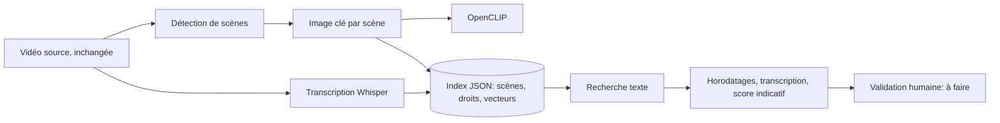

# Archive Sauvée

> Rendre les archives audiovisuelles cherchables, sans remplacer le jugement de l'archiviste.

Projet pour le hackathon **IA Éthique 360**, consacré à l'intégration de l'IA dans les industries audiovisuelles à vocation culturelle.

## 1. Problème étudié

Notre hypothèse est que retrouver une séquence dans une archive audiovisuelle peu documentée peut demander un visionnage manuel long et rendre des contenus culturels difficiles à réutiliser. **Cette hypothèse reste à valider sur le terrain.** Le cahier des charges du hackathon demande d'observer, d'écouter et de vérifier le problème auprès des personnes concernées. À ce jour, ce dépôt ne contient ni entretien documenté, ni observation attribuable, ni source de terrain vérifiée. Nous ne présentons donc pas cette hypothèse comme un constat établi.

La prochaine étape terrain est un échange avec un ou une archiviste, documentaliste audiovisuel, documentariste ou enseignant en cinéma. La date, le rôle de la personne et ses propos ne seront ajoutés ici qu'après l'échange et avec son accord.

## 2. Solution et état du prototype

Le prototype en ligne de commande prend une vidéo dont les droits d'utilisation ont été vérifiés, détecte ses changements de scène, extrait une image clé par scène, transcrit l'audio avec Whisper, calcule des représentations visuelles avec OpenCLIP et enregistre les résultats dans un index JSON. La recherche classe les scènes à partir d'une requête texte et affiche les horodatages, la transcription disponible et un score de similarité indicatif.

Les suggestions portent le statut `proposé`. Ce score n'est ni une probabilité calibrée ni une mesure de précision. L'outil ne valide aucune métadonnée à la place d'un archiviste et n'altère pas la vidéo originale. Il n'effectue ni reconnaissance faciale, ni détection d'émotions, ni inférence d'origine, de religion ou d'identité.

### Limites connues

- Aucun clip autorisé n'est fourni dans le dépôt : l'équipe doit choisir un fichier dont elle peut justifier les droits et usages.
- Aucun test de qualité, de vitesse ou de précision n'a encore été consigné. La qualité du français, de l'arabe et du tunisien n'est donc pas mesurée.
- Le modèle CLIP configuré utilise des poids LAION `ViT-B-32`; sa pertinence pour des requêtes françaises ou tunisiennes doit être évaluée, pas présumée.
- La transcription est faite sur le CPU et l'installation des modèles peut demander beaucoup de temps, d'espace disque et de mémoire. Les poids sont téléchargés par les bibliothèques au premier lancement, puis l'inférence se fait localement.
- Pas encore d'interface de validation, d'OCR, de gestion multi-utilisateur ou de mesure d'empreinte énergétique.

## 3. Rôle de l'IA

| Étape | Outil | Sortie et contrôle humain |
|---|---|---|
| Découpage | PySceneDetect | Limites de scènes proposées automatiquement |
| Transcription | Whisper | Texte proposé, à écouter et corriger |
| Recherche visuelle | OpenCLIP | Similarité texte-image indicative, à interpréter |
| Recherche textuelle | Correspondance de mots simple | Signal complémentaire, pas une compréhension garantie |

Ces modèles pré-entraînés ne sont pas réentraînés par ce prototype. Les appels de calcul sont locaux une fois les dépendances et poids installés. L'installation initiale nécessite toutefois un accès aux dépôts de paquets et au téléchargement des poids.

## 4. Éthique à 360°

- **Créateurs :** l'index est une aide à la consultation; l'archiviste garde la décision et doit pouvoir corriger ou rejeter les propositions.
- **Droits :** chaque vidéo indexée doit déclarer titulaire, licence/statut et usages autorisés. Ces champs sont obligatoires lors de l'ingestion; ils ne constituent pas une vérification juridique.
- **Données :** ne pas soumettre de vidéo sans droit d'accès et d'usage suffisant. L'index contient des transcriptions, des chemins de fichiers et des représentations numériques; il doit être protégé comme le contenu source.
- **Cultures et langues :** les performances sur le français, l'arabe et le tunisien restent à mesurer. Les erreurs de transcription ou de recherche peuvent rendre des séquences moins visibles.
- **Transparence :** la sortie indique qu'elle est proposée par une IA et montre un score indicatif. L'interface actuelle reste la ligne de commande.
- **Planète :** l'indexation exécute plusieurs modèles et consomme du calcul. Aucun relevé énergétique n'a été effectué; éviter de revendiquer un gain environnemental mesuré.

## 5. Architecture



## 6. Installation et démonstration

Prérequis : Python 3.10 ou ultérieur, `ffmpeg` accessible dans le `PATH`, et une connexion Internet lors de l'installation et du premier téléchargement des poids.

```powershell
git clone https://github.com/amine-jelassi7/IA-ethique-Hackathon.git
cd IA-ethique-Hackathon
py -3 -m venv .venv
.venv\Scripts\Activate.ps1
python -m pip install --upgrade pip
python -m pip install -r requirements.txt
```

Sous macOS/Linux, créez l'environnement avec `python3 -m venv .venv`, activez-le avec `source .venv/bin/activate`, puis exécutez les mêmes commandes `python -m pip`.

Placez votre vidéo autorisée dans `data/clips/` (ce dossier est ignoré par Git), puis renseignez ses droits réels :

```powershell
python src/ingest.py --video data/clips/mon_extrait.mp4 --rights-holder "TITULAIRE À RENSEIGNER" --license "LICENCE OU STATUT VÉRIFIÉ" --allowed-uses "USAGES AUTORISÉS À RENSEIGNER"
python src/search.py "une scène de marché" --top-k 5
```

Les valeurs d'exemple doivent être remplacées par les informations vérifiées du clip. Une incertitude sur les droits doit être signalée explicitement; ne pas présenter le fichier comme libre de droits. L'index est écrit dans `data/index.json` et les images extraites dans `data/frames/`; ces éléments sont ignorés par Git.

## 7. Données, licences et provenance

| Ressource | État |
|---|---|
| Vidéos de démonstration | Aucune incluse. Source, titulaire, licence et usages devront être documentés pour chaque clip retenu. |
| PySceneDetect | BSD 3-Clause selon le dépôt officiel. |
| Whisper et OpenCLIP | Bibliothèques et poids configurés; vérifier et documenter séparément les licences applicables aux versions et poids effectivement distribués avant publication. |
| Licence de ce projet | À décider par l'équipe; aucun fichier de licence n'est encore fourni. |

Références techniques : [PySceneDetect](https://github.com/Breakthrough/PySceneDetect), [Whisper](https://github.com/openai/whisper), [OpenCLIP et ses modèles pré-entraînés](https://github.com/mlfoundations/open_clip).

## 8. Équipe et prochaines étapes

Les noms, rôles, disponibilité matérielle et répartition des tâches doivent être confirmés par l'équipe avant d'être publiés. Ils ne sont pas documentés dans cette version.

- [ ] Obtenir et consigner un retour de terrain réel.
- [ ] Choisir un ou plusieurs clips et documenter leurs droits et usages autorisés.
- [ ] Exécuter l'ingestion et noter les erreurs observées sur français, arabe et tunisien, sans inventer de métriques.
- [ ] Faire une démonstration reproductible sur une machine propre et consigner les contraintes matérielles.
- [ ] Décider de la licence du projet et vérifier les licences des modèles/poids effectivement utilisés.
- [ ] Confirmer l'équipe, sa répartition des tâches et préparer les livrables du hackathon en français.
