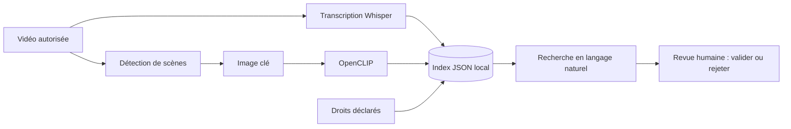

<div align="center">

# ArchivIA

**La mémoire audiovisuelle, retrouvée sans être réécrite.**

[](https://www.python.org/)
[](LICENSE)
[](#prototype)
[](#solution)


Projet de la 5e édition du hackathon **IA Éthique 360** · Junior Entreprise INSAT × OIF

</div>

ArchivIA aide les archivistes et documentalistes à retrouver une scène dans une vidéo en la décrivant avec leurs propres mots. Il crée un index local : la vidéo originale n'est jamais modifiée, et chaque résultat reste une **suggestion à vérifier par une personne**.

<p align="center">
  
</p>

> **État du projet :** le prototype fonctionne sur un extrait local. Sa qualité, sa vitesse et ses performances en français, arabe et tunisien restent à mesurer.

## 🧭 En un coup d'œil

| Sujet | Réponse courte |
|---|---|
| **Problème** | Retrouver une séquence dans une archive peu décrite demande souvent un visionnage manuel long. |
| **Solution** | Découpage en scènes, transcription et recherche texte-image dans un index local. |
| **Rôle de l'IA** | Proposer et classer des scènes ; jamais décider de leur valeur, de leurs droits ou de leur publication. |
| **Public visé** | Archives, cinémathèques, télévisions, radios et institutions culturelles. |
| **Langues** | Français en priorité ; arabe et tunisien prévus, avec une évaluation séparée par langue. |

## Sommaire

- [Le problème et ses preuves](#probleme)
- [La solution et la place de l'IA](#solution)
- [Éthique à 360°](#ethique)
- [Prototype et fonctionnement](#prototype)
- [Installation rapide](#installation)
- [Impact, viabilité et suite](#suite)
- [Données, droits et licences](#droits)

<a id="probleme"></a>
## 🔎 Le problème et ses preuves

> **Problème formulé :** un archiviste ou documentaliste audiovisuel doit retrouver une séquence précise dans un fonds peu documenté. Cela peut imposer un visionnage long, limiter la réutilisation des œuvres et rendre certains contenus moins visibles.

| Élément | Niveau de preuve |
|---|---|
| Les supports audiovisuels vieillissent et les équipements de lecture disparaissent. | Documenté par l'[UNESCO et l'IASA](https://iasa-web.org/node/5374). |
| Les institutions tunisiennes rencontrent des difficultés de traitement et de numérisation. | Déclarations publiques des [Archives nationales de Tunisie](https://www.webmanagercenter.com/2025/10/30/554833/hedi-jallab-les-archives-nationales-oeuvrent-a-sauver-les-supports-audiovisuels-anciens/). |
| L'indexation est un enjeu professionnel. | Mentionnée dans un [compte rendu de formation à Tunis](https://haca.ma/fr/print/4626). |
| Retrouver une séquence précise prend beaucoup de temps dans ces fonds. | **Hypothèse à confirmer sur le terrain.** Aucun entretien exploitable n'a encore été mené par l'équipe. |

Les sources montrent surtout l'urgence de préserver et numériser. ArchivIA intervient **après la numérisation** : un fichier sauvegardé reste difficile à utiliser lorsqu'il n'est pas décrit scène par scène.

### Notre démarche de validation

Nous avons réalisé une première veille documentaire et exécuté la chaîne technique sur un extrait local. La prochaine étape est de mener au moins deux entretiens avec des professionnels indépendants et d'observer une recherche réelle : temps passé, outils utilisés, difficultés et attentes face à une suggestion automatique.

Nous ne présenterons pas le besoin de repérage comme validé tant que ces éléments ne seront pas recueillis avec l'accord des personnes concernées.

<a id="solution"></a>
## 🤖 La solution et la place de l'IA

ArchivIA transforme une vidéo autorisée en scènes consultables. Une requête telle que « une scène de marché » renvoie des images clés, des horodatages, une transcription et un score indicatif.

| Étape | Ce que fait le système | Ce que reçoit l'utilisateur |
|---|---|---|
| 1. Ingestion | Détecte les scènes, extrait une image clé et transcrit l'audio. | Scènes horodatées. |
| 2. Indexation | Enregistre localement les scènes, les droits déclarés et les représentations visuelles. | Un index JSON sur la machine. |
| 3. Recherche | Compare la requête avec les images et la transcription. | Une liste de scènes proposées. |
| 4. Revue humaine | L'utilisateur valide ou rejette une suggestion. | Une décision traçable dans l'index. |

### Pourquoi utiliser l'IA ?

Une archive audiovisuelle contient de l'image et du son, souvent sans description détaillée. Whisper rend la parole recherchable. OpenCLIP rapproche une description en langage naturel d'une image. Ces modèles réduisent le nombre de scènes à examiner ; ils ne remplacent pas l'expertise documentaire.

| L'IA peut | L'IA ne peut pas |
|---|---|
| Proposer des limites de scène, une transcription et des résultats classés. | Garantir qu'un résultat est pertinent, exact ou complet. |
| Calculer une similarité entre texte et image. | Vérifier les droits, publier une œuvre ou choisir son interprétation. |
| Afficher un score indicatif. | Identifier des personnes, leurs émotions, leur origine, leur religion ou leur identité. |

**Choix technique :** aucun modèle n'est réentraîné et aucune image ni voix n'est générée. Cette approche limite le périmètre, facilite l'audit et conserve la main aux professionnels.

<a id="ethique"></a>
## 🧭 Éthique à 360°

Le cahier des charges demande d'examiner six angles. Voici nos choix, les risques reconnus et les actions prévues.

| Angle | Notre engagement | Risque reconnu | Garde-fou / prochaine étape |
|---|---|---|---|
| **Créateurs** | La vidéo source reste intacte ; l'IA ne génère ni ne remonte d'images. | Décontextualisation ou effacement du travail éditorial. | Validation humaine, crédits et provenance conservés dans les métadonnées. |
| **Droits** | Titulaire, licence/statut et usages autorisés sont renseignés avant l'indexation. | Déclaration inexacte ou réutilisation non autorisée. | Fiche de droits, revue avant pilote et procédure de retrait. |
| **Données** | Traitement et index locaux ; aucun clip n'est envoyé vers un service cloud par ArchivIA. | Contenu sensible ou accès non autorisé à l'index. | Minimisation des données ; contrôle d'accès et politique de conservation à définir avant pilote. |
| **Cultures et langues** | Le français est au cœur du projet ; arabe et tunisien sont pris en compte. | Biais ou performances inégales selon la langue et la culture. | Corpus annoté et mesures séparées : WER et précision par langue. |
| **Transparence** | Chaque scène générée porte le statut `proposé` et un score non probabiliste. | Fausse confiance dans le résultat. | Versions des modèles visibles, décisions de validation enregistrées, résultats contestables. |
| **Planète** | Pas d'entraînement de modèle ; utilisation de modèles existants et traitement local. | Consommation de calcul et de stockage non mesurée. | Mesurer les kWh par heure de vidéo ; privilégier les modèles et traitements adaptés au besoin. |

### Nos limites et refus explicites

- Pas de reconnaissance faciale, d'émotions ou d'inférence identitaire.
- Pas de décision, publication ou validation automatique.
- Pas de clip fourni dans le dépôt : les droits sont à justifier pour chaque vidéo indexée.
- Pas de revendication de précision, de gain de temps ou de sobriété énergétique avant mesure.

<a id="prototype"></a>
## 🛠️ Prototype et fonctionnement



| Fonction | État actuel |
|---|---|
| Détection de scènes, image clé, transcription et recherche | Fonctionnent sur un extrait de test local. |
| Interface NiceGUI | Recherche, consultation et validation/rejet disponibles localement. |
| Métadonnées de droits | Collectées de manière déclarative ; aucune vérification juridique automatique. |
| OCR, identification des locuteurs, gestion multi-utilisateur | Non implémentés. |
| Évaluation de la précision, de la vitesse et de l'énergie | Non réalisée. |

Technologies principales : Python 3.10+, PySceneDetect, Whisper, OpenCLIP, PyTorch, OpenCV, `ffmpeg`, JSON et NiceGUI. Whisper utilise CUDA lorsqu'il est disponible, sinon le CPU.

<a id="installation"></a>
## 💻 Installation rapide

**Prérequis :** Python 3.10+, `git`, `ffmpeg` dans le `PATH`, plusieurs Go d'espace disque et une connexion Internet au premier lancement pour récupérer les poids des modèles.

```bash
git clone https://github.com/amine-jelassi7/IA-ethique-Hackathon.git
cd IA-ethique-Hackathon
python3 -m venv .venv
source .venv/bin/activate
python -m pip install -r requirements.txt
```

Sous Windows, activez l'environnement avec `./.venv/Scripts/Activate.ps1`. Installez `ffmpeg` avec votre gestionnaire de paquets (`winget install --id Gyan.FFmpeg -e`, `brew install ffmpeg` ou `sudo apt install ffmpeg`).

Lancez l'interface locale :

```bash
python src/app.py
```

Puis ouvrez `http://127.0.0.1:8080`. Laissez le terminal ouvert pendant l'utilisation et arrêtez le serveur avec `Ctrl+C`.

Pour utiliser la ligne de commande, placez une vidéo dont les droits sont justifiés dans `data/clips/`, puis :

```bash
python src/ingest.py --video data/clips/mon_extrait.mp4 --rights-holder "TITULAIRE VÉRIFIÉ" --license "LICENCE OU STATUT VÉRIFIÉ" --allowed-uses "USAGES AUTORISÉS" --language fr
python src/search.py "une scène de marché" --top-k 5
```

Les scores de recherche ne sont pas des probabilités de justesse. Chaque scène doit être examinée avant usage.

<a id="suite"></a>
## 🌍 Impact, viabilité et suite

ArchivIA vise à rendre les archives culturelles plus consultables sans effacer les langues, les droits ou le travail des personnes qui les documentent. Il s'adresse d'abord aux structures qui possèdent des fonds numérisés mais peu décrits : archives publiques, cinémathèques, télévisions, radios, universités et associations culturelles.

| Étape | Objectif vérifiable |
|---|---|
| **Validation terrain** | Entretiens et observation d'une tâche de recherche avec des archivistes. |
| **Évaluation** | Corpus autorisé, mesures de précision, temps de recherche et qualité par langue. |
| **Pilote** | Une structure partenaire, un référent archiviste et un journal des corrections. |
| **Viabilité** | Tester une offre de déploiement, d'accompagnement, de formation ou de maintenance avec les structures pilotes. |

Le modèle économique reste à confirmer par les entretiens et le pilote. Nous ne présentons encore ni prix, ni revenus, ni partenariats comme acquis.

<a id="droits"></a>
## 📚 Données, droits et licences

| Ressource | Statut |
|---|---|
| Code ArchivIA | Licence [MIT](LICENSE). |
| Vidéos à indexer | Non incluses ; droits et usages doivent être documentés clip par clip. |
| Whisper, OpenCLIP et autres dépendances | Licences propres à vérifier, y compris celles des poids préentraînés. |
| Démonstration | `docs/demo.gif` est une capture produite par l'équipe ; le clip de test n'est pas distribué. |

Une fiche minimale doit accompagner chaque clip : titulaire des droits, licence ou statut, usages autorisés, source, date de vérification et restrictions. En cas de signalement par un ayant droit, l'index et les images clés concernés seront retirés et la décision documentée.

## 👋 Équipe et contribution

| Membre | Rôle |
|---|---|
| [@amine-jelassi7](https://github.com/amine-jelassi7) | Étudiant en génie logiciel |
| [@RayenMnif](https://github.com/RayenMnif) | Étudiant en génie logiciel |
| [@XAFKTHECODER](https://github.com/XAFKTHECODER) | Étudiant en génie logiciel |
| [@YWilix](https://github.com/YWilix) | Étudiant en génie logiciel |

Les retours d'archivistes, de spécialistes des droits, de professionnels de l'audiovisuel et de chercheurs sont bienvenus via les issues du dépôt. Aucun témoignage n'est publié sans accord.

<div align="center">
<sub>Prototype réalisé pour la 5e édition d'IA Éthique 360 · Junior Entreprise INSAT × Organisation internationale de la Francophonie.</sub>
</div>
